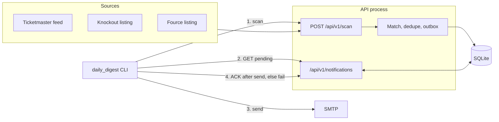

# Architecture

One local process serves the API and owns a SQLite file. A separate CLI process runs the daily job over HTTP: scan, build one Polish e-mail, then acknowledge. The OS scheduler starts that CLI. Nothing here is multi-user or multi-instance.

## Flow

`POST /api/v1/scan` holds an in-process lock, fetches the selected sources one after another, then `process_events` commits once.

For each raw event:

1. Drop it if `local_date` is before today. A missing date is kept.
2. Upsert `source_events` on `(source, source_event_id)`. Ticketmaster uses its event id, Knockout the detail page number, and Fource the last segment of the event URL. An event without an id falls back to a hash of source plus normalized URL.
3. Match participants to enabled watched artists. The event country must be one of the artist's countries. An exact canonical name or alias wins. Fuzzy matching (`rapidfuzz` ratio ≥ 92 against the name and its aliases) runs only when `match_mode` is not `strict` and both the artist name and the participant name have at least 6 characters. A small blocklist of generic names (currently `health`) is never fuzzy-matched.
4. Attach the source row to one `canonical_events` row: same artist, country, date, and normalized city, plus a compatible venue. A missing venue on either side counts as compatible. Otherwise the venues must be equal, one must contain the other, or the higher of `rapidfuzz` `ratio` and `token_set_ratio` must be ≥ 80. No date or no city means the source row is stored and no canonical event is created.
5. Queue `notification_outbox` for a new canonical event, a canonical status that becomes cancelled, postponed, or rescheduled, or a date or venue change on a source row that already existed. Other status changes, such as sold out, are stored but not sent. `notification_key` is unique, so the same change is not queued twice. Pending payloads keep their event snapshot; only the `sources` list is refreshed when another source links.

The CLI sends up to `DIGEST_LIMIT` (default 200) pending rows as one digest; any rest waits for the next run. `ACK` runs only after SMTP accepts the message. `/fail` leaves the row `pending` and increments `attempts`.

Canonical status is the strongest linked source: cancelled, then postponed or rescheduled, then sold out, on sale, scheduled, unknown.

## Decisions

- SQLite and one API process on `127.0.0.1`; Docker publishes the port on loopback only.
- The CLI goes through the API instead of opening the database. SQLite then has a single writing process, and the scan lock, which lives in that process, covers both the scheduled run and scans started by hand. The API never sends mail; SMTP code runs only in the CLI.
- An outbox instead of sending mail inside the scan. A failed send does not roll back stored events.
- Source rows stay separate and point at a canonical event. Two listings of the same show become one notification, with both URLs.
- Promoters without an adapter (eBilet, Eventim, Going, Live Nation) are registered as stubs, off by default. Enabling one marks that source `degraded` on every scan. The scan continues, but with an empty outbox the CLI then exits 1.
- Promoter pages are parsed without a browser. `robots.txt` is checked first, requests wait `CRAWLER_MIN_DELAY_SECONDS`, and a redirect to another domain, a redirect loop, or a listing that no longer matches the parser marks the source `degraded`. An empty or broken page is not treated as "no concerts".
- `GET /health` only checks that the process is up. It does not open the database.

## Trade-offs

- Delivery is at-least-once. If ACK stops halfway, the log lists acknowledged and still-pending ids. The next run sends the pending ones again.
- The scan lock is an `asyncio.Lock` in that process. A second scan gets HTTP 409. Two API processes, or two digest runs, are not coordinated. Do not run two digests at once.
- Fuzzy matching and venue merging will both miss odd spellings and occasionally merge two shows. A name under 6 characters never fuzzy-matches; add an alias.
- A date or venue alert is emitted only when that source row already existed. The first time a second source attaches to a canonical event, it does not emit `DATE_CHANGED` or `VENUE_CHANGED`.
- `DATE_CHANGED:{id}:{date}` and `VENUE_CHANGED:{id}:{venue}` do not fire again for a value already used in a key. A later new date does.
- Every scan downloads the full Ticketmaster country feed and re-reads the promoter listings. There is no `ETag` or `If-Modified-Since`.
- Knockout and Fource are Poland-only. An event in a city outside the parser's list of Polish cities gets no country and is dropped before it is stored.
- `--dry-run` still runs the scan, so it can insert a `NEW_EVENT`. It does not send mail and does not ACK.

## Failure modes

| What happens | Result |
| --- | --- |
| One source times out, returns HTTP 4xx/5xx, or its HTML changed | That source is `error` or `degraded`. Other sources are still stored. `scan_runs.status` stays `completed` if the pipeline commits. |
| Empty `TICKETMASTER_API_KEY` | Ticketmaster is `degraded`. Knockout and Fource still run. |
| Source problems and an empty outbox | The CLI prints the source errors and exits 1. That is not "no new concerts". |
| Source problems and pending rows | The digest is still sent and includes the source errors. |
| SMTP fails | `/fail` on each id in the batch. Rows stay `pending`. CLI exits 1. |
| SMTP succeeds, then an ACK fails | Acknowledged rows are `sent`. The rest stay `pending` and are mailed again on the next run. CLI exits 1. |
| Scan still holding the lock | CLI gets 409, sends nothing, and exits 2. |
| Scan takes longer than `DIGEST_HTTP_TIMEOUT_SECONDS` (default 600) | CLI exits 1 without retrying, since a retry would only get 409. The scan finishes in the API and its notifications go out on the next run. |
| Pipeline throws after the scan row is inserted | `scan_runs.status` is set to `failed` and the exception propagates. Per-source errors do not take this path. |
| Both `SMTP_USE_TLS` and `SMTP_USE_SSL` without `--dry-run` | CLI exits 2 before the scan. |
